<h1 align="center">teetime-monitor</h1>

  <strong>Eine Tee-Zeit zu buchen dauert eine Minute. Die richtige zu finden die ganze Woche.</strong> 
  Die Startliste deines Golfclubs, die sich von selbst aktuell hält — mit Wetter, Tageslicht und deinen
  eigenen Vorgaben schon eingerechnet, sodass die Zeit, die sich lohnt, markiert ist, bevor du suchst.

  
  
  
  

<a href="README.md">🇬🇧 English</a> · 🇩🇪 <strong>Deutsch</strong>

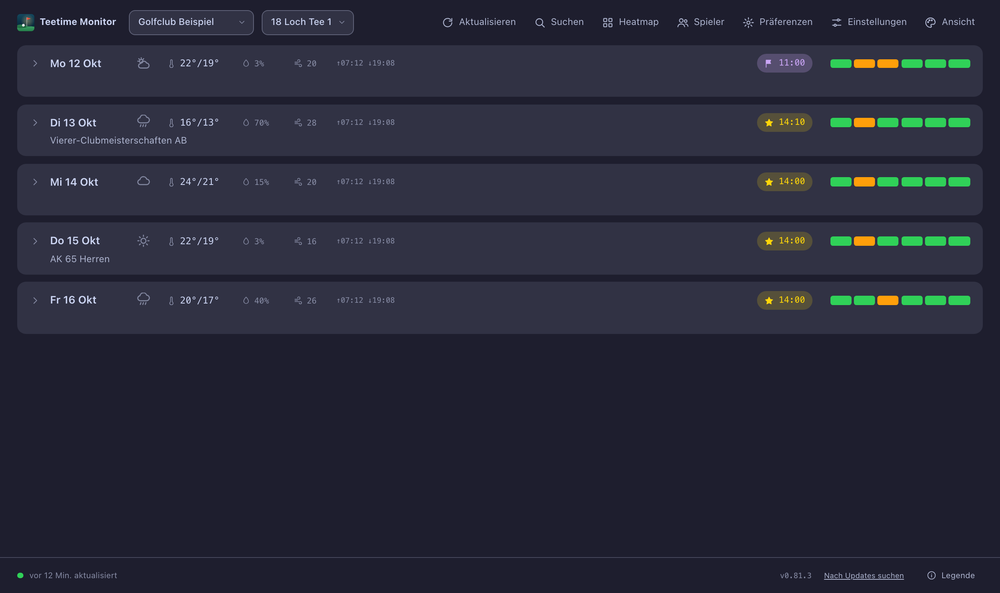

## Was es macht

Golfclubs im deutschsprachigen Raum veröffentlichen ihre Startlisten über die Buchungsplattform **pc caddie**:
wer wann spielt, welche Zeiten noch frei sind. Die Liste ist öffentlich. Teetime Monitor liest sie für dich und
ergänzt, was die Seite des Clubs dir nicht sagt:

- ⛳ **Wie viele Zeiten an jedem Tag zu deinen Vorgaben passen** — die Zahl antippen zeigt sie; im geöffneten Tag
  ist die beste mit ★ markiert: trocken, wenig Wind, Platz um deine Gruppe, Tageslicht in Reserve. Oder der Grund,
  warum es keine gibt („Regen“, „dunkel“).
- 🌦 **Die Vorhersage für jede einzelne Startzeit**, nicht nur für den Tag.
- 🌙 **Eine Warnung, wenn die Runde vor Sonnenuntergang nicht fertig würde.**
- 👥 **Wer spielt** — Freunde, die du markierst, bekommen einen Stern.
- 🔔 **Ein Hinweis, wenn sich deine Buchung ändert**: jemand kommt in deinen Flight, die Vorhersage kippt.
- 📈 **Eine Auslastungs-Heatmap**, die über die Wochen lernt, welche Stunden wirklich voll werden.

**Es bucht nur, wenn du den Knopf drückst.** Klicke auf eine freie Zeit und wähle *Jetzt buchen*: Die App bucht sie bei
pc caddie mit deinem eigenen Login, mit den Freunden aus deiner pc-caddie-Freundesliste, die du antippst, und
pc caddie schickt die übliche Bestätigungs-E-Mail. Deine eigene Buchung kannst du genauso stornieren. Nichts wird
automatisch oder nach Zeitplan gebucht.

## Zwei Wege, dasselbe Ergebnis

| 🖥 **Im Browser** (`teetime-monitor-web`) | ⌨️ **Im Terminal** (`teetime-monitor`) |
|---|---|
| Knöpfe, Karten, Farben — die einfache Variante. Geht auch auf Handy und Tablet (siehe Raspberry Pi unten). | Für alle, die im Terminal zu Hause sind: schnell, nur Tastatur. |

  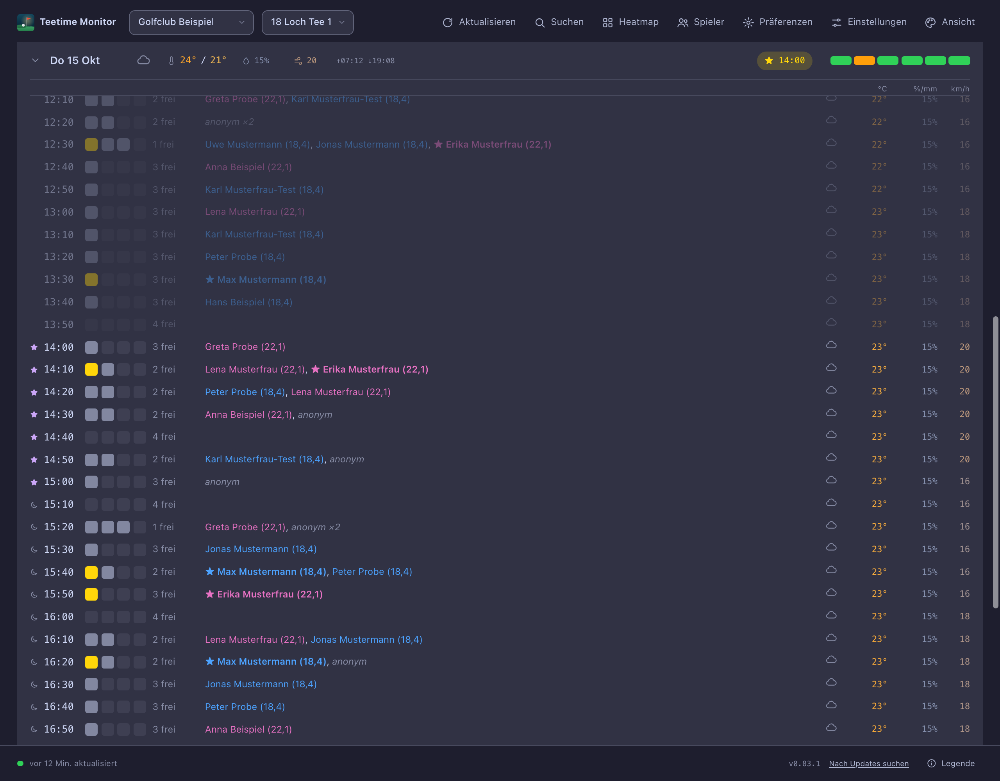
  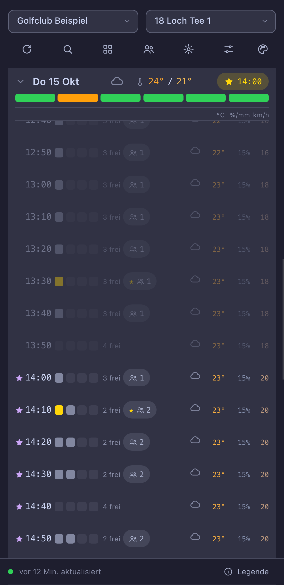

## Loslegen

Such dir die Zeile aus, die zu dir passt. Alles ist kostenlos, nirgends musst du dich anmelden.

| Du hast | So geht's |
|---|---|
| 🍎 **Einen Mac** | [Homebrew](https://brew.sh) installieren, dann in der Terminal-App: `brew install ltdan-88/teetime-monitor/teetime-monitor`. Starten mit `teetime-monitor-web` (Browser) oder `teetime-monitor` (Terminal). |
| 🪟 **Windows** | **TeetimeMonitor-…-windows-x64.zip** vom [neuesten Release](https://github.com/ltdan-88/teetime-monitor/releases/latest) laden, Rechtsklick → *Eigenschaften* → *Zulassen* ankreuzen, dann *Alle extrahieren*. Ordner öffnen und **TeetimeMonitor-Web.cmd** doppelklicken. (Meldet Windows „Der PC wurde geschützt“: *Weitere Informationen → Trotzdem ausführen* — die App hat keine bezahlte Signatur.) Es wird nichts installiert; alles bleibt in diesem Ordner. |
| 🐧 **Linux** | **TeetimeMonitor-…-linux-x86_64.tar.gz** vom [neuesten Release](https://github.com/ltdan-88/teetime-monitor/releases/latest) laden, entpacken und `./TeetimeMonitor-Web.sh` starten. Oder Homebrew wie auf dem Mac. |
| 🍓 **Einen Raspberry Pi** (oder einen anderen Rechner, der immer läuft) | Läuft den ganzen Tag für die ganze Familie — jedes Handy, Tablet und jeder Computer zu Hause öffnet es im Browser, hinter einem Passwort: [**Raspberry-Pi-Anleitung**](docs/RASPBERRY-PI.de.md). |

Es öffnet sich ein Fenster mit deiner Woche. **Schließt du das Fenster, endet das Programm** — außer auf einem Raspberry Pi.

### Deine ersten fünf Minuten

1. **Club finden.** Oben das Club-Menü öffnen, **＋ Club hinzufügen…** wählen und nach dem Namen suchen — oder den
   Buchungslink deines Clubs bei pc caddie einfügen. Zum Lesen der Startliste ist kein Login nötig.
2. **Die Woche ansehen.** Jede Karte ist ein Tag. Die Zahl sagt, wie viele Zeiten zu deinen Vorgaben passen (antippen
   zeigt sie), eine Fahne ist eine Zeit, die du gebucht hast.
3. **Einen Tag anklicken**, um alle Startzeiten zu sehen — mit den Spielern und dem Wetter für jede. Der ★ markiert die beste.
4. **Deine Vorgaben** einmal unter **Präferenzen** eintragen — welche Zeiten werktags und am Wochenende passen, wie viele
   Spieler, wie viel Wind oder Regen du hinnimmst. Ab dann richtet sich der ★ nach dir.
5. **Zeit gefunden?** Anklicken und *Jetzt buchen* wählen (braucht deinen pc-caddie-Login unter Einstellungen). Gebucht wird
   bei pc caddie, und ab dann behält die App die Buchung für dich im Auge.

Optional, schaltet mehr frei: ein **pc-caddie-Login** (Einstellungen) zeigt echte Spielernamen, deine eigenen Buchungen
und das Spielerverzeichnis.

## Ein Rundgang

<table>
<tr>
<td width="50%"><b>Suchen</b> — jede freie Zeit der kommenden Tage, mit einem Tipp eingegrenzt: ein Tag, eine Tageszeit, freie Plätze, Freunde. Es öffnet mit deinen eigenen Vorgaben, du änderst nur eine Sache.  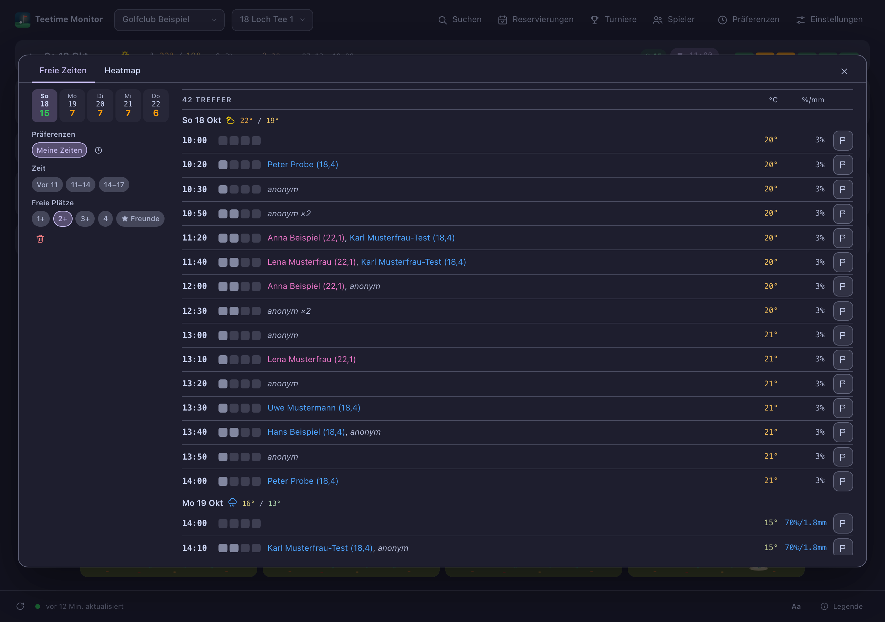</td>
<td width="50%"><b>Auslastungs-Heatmap</b> — welche Stunden an welchem Wochentag voll werden, gelernt aus deinem eigenen Verlauf. Sie braucht erst ein paar Wochen Daten.  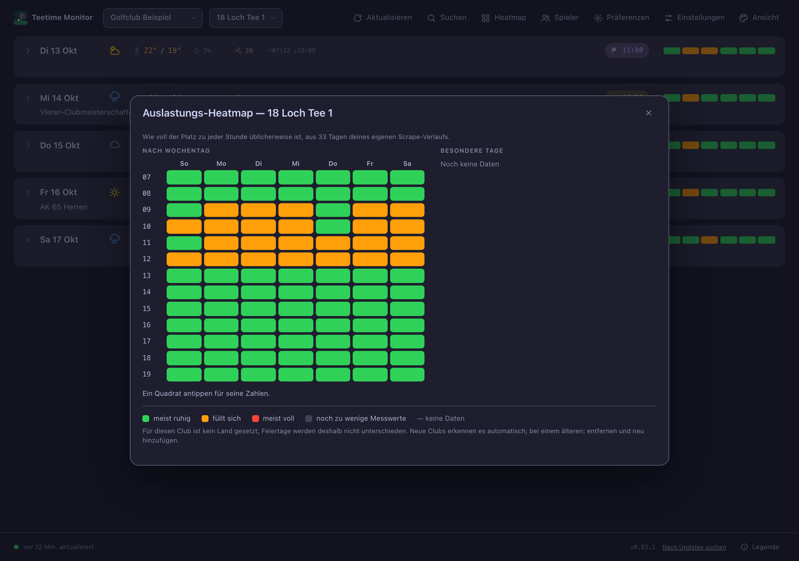</td>
</tr>
<tr>
<td width="50%"><b>Spieler</b> — markiere Freunde mit einem Stern; ihre Namen erscheinen fett mit ★, und eine Präferenz kann ihre Flights bevorzugen. Direkt zur nächsten Startzeit eines Freundes springen.  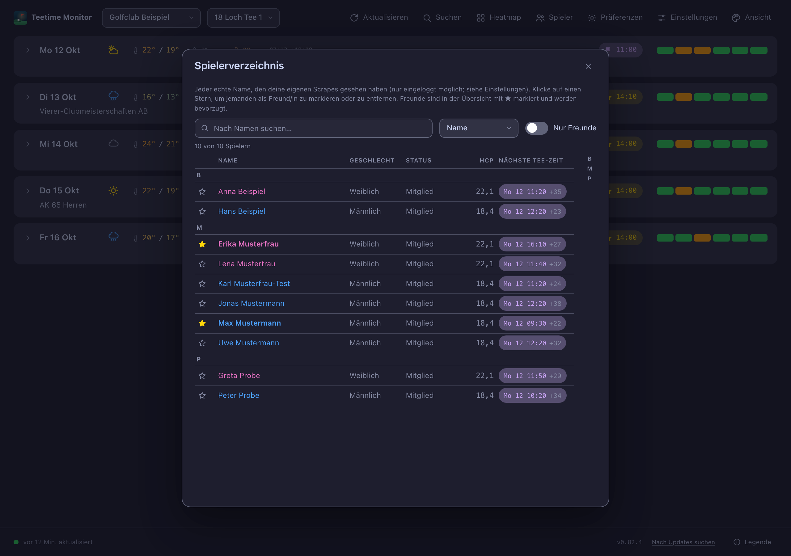</td>
<td width="50%"><b>Auf dem Handy</b> — die Seite passt sich Handy und Tablet an. Etwas berühren und halten erklärt es. „Zum Home-Bildschirm“ gibt ihr ein App-Symbol.  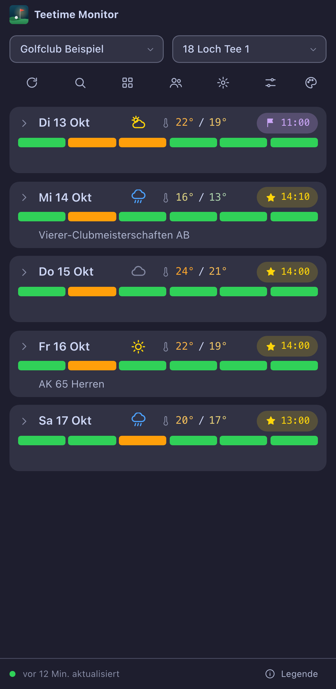</td>
</tr>
</table>

Der ★ ist nicht einfach die früheste Zeit. Jede spielbare Zeit wird bewertet nach dem Wetter über die ganze Runde (gegen
*deine* Grenzen), Platz um deine Gruppe, einer ruhigen Stunde und Tageslicht in Reserve — kostenlos, auf deinem eigenen
Rechner, ohne KI. Der geöffnete Tag nennt den Grund, z. B. „trocken · viel Platz um dich · Tageslicht in Reserve“. Ist
dein Platz zu dunkel für die Runde, ein kürzerer im Club aber passt noch, schlägt es stattdessen den vor. Ein Tag, der
noch nicht buchbar ist, zeigt 🔒 und wann er aufgeht. Das Wettersymbol eines geöffneten Tages antippen zeigt seine
Vorhersage bei meteoblue, Windy, Ventusky oder Yr, und eine Buchung kommt mit einem Tipp in **Meine Reservierungen** in
Outlook, den Google Kalender oder Apples Kalender (beides unter Einstellungen → Darstellung). Dort hat jede Buchung
auch **deine Scorekarte**: aus den Platzdaten des Clubs und deinem Handicap-Index deine Vorgabeschläge an jedem Loch,
dein Par, wo du aufnehmen kannst, und wie viele Stableford-Punkte besser sind als dein Handicap.

### Lieber im Terminal?

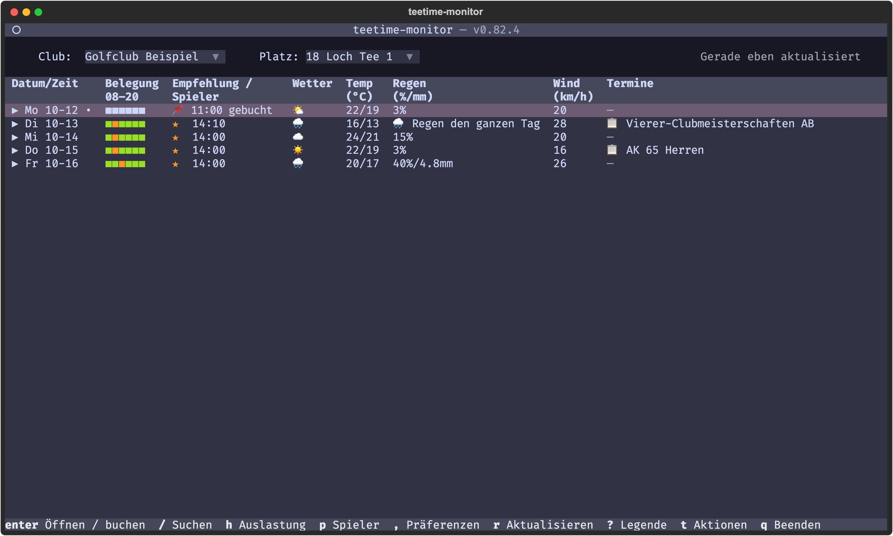

Dieselbe Woche, derselbe ★, dieselben Vorgaben. Jeder Bildschirm hat eine Taste, unten in der Leiste angezeigt:

| | Browser | Terminal |
|---|---|---|
| Tag öffnen · freie Zeit buchen oder Buchung stornieren | Klick | **enter** |
| Jetzt aktualisieren | **r** | **r** |
| Suchen | **s** | **/** |
| Heatmap | **h** | **h** |
| Spieler | **p** | **p** |
| Meine Reservierungen (Buchungen ansehen und stornieren) | **b** | **b** |
| Turniere (der Kalender des Clubs als Monatsansicht) | **t** | – |
| Vergangene Tage | **v** | – |
| Präferenzen · Einstellungen | **e** · **,** | **,** · **s** |
| Club hinzufügen | **a** | **a** |
| Legende (was jedes Symbol heißt) | **?** | **?** |
| Fenster schließen · beenden | **esc** | **esc** · **q** |

Das Terminal hat außerdem ein **Aktionen**-Menü (**t**) und elf Farbschemata; im Browser findest du die Schemata unter
**Einstellungen → Darstellung**, zusammen mit Deutsch/Englisch und Einheiten. Die Textgröße ist das **Aa** unten.

Mehr Terminal-Bilder

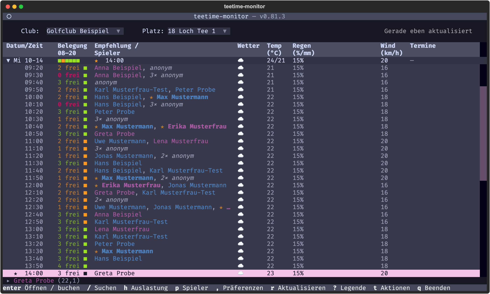

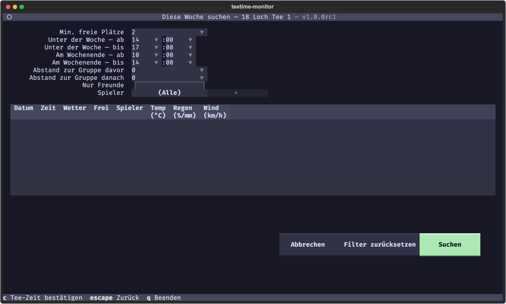

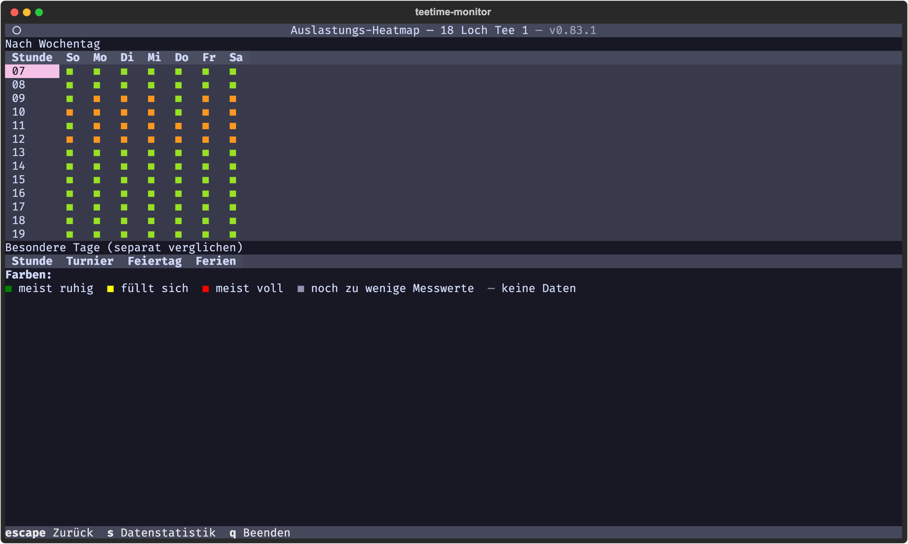

## Gut zu wissen

- **Es hält sich selbst aktuell, solange es offen ist.** Damit auch bei geschlossenem Programm weiter Startlisten
  gesammelt werden — das braucht die Heatmap, weil pc caddie vergangene Tage löscht —, lass einen Raspberry Pi das
  übernehmen oder richte einen kleinen geplanten Auftrag ein: [docs/ADVANCED.de.md](docs/ADVANCED.de.md).
- **Updates:** die Seite sagt dir, wenn es eine neue Version gibt („Version X ist verfügbar“), und wie du sie bekommst.
  Mac: `brew upgrade teetime-monitor`; Windows und Linux: neues Zip laden und den alten Ordner `userdata` hineinkopieren;
  Raspberry Pi: ein Klick auf **Jetzt aktualisieren**, oder es installiert Updates nachts von selbst (Einstellungen → Über).
- **Deine Daten bleiben bei dir.** Dein pc-caddie-Login geht nur an pc caddie selbst. Die Browser-Version hört nur auf
  deinem eigenen Rechner (die Raspberry-Pi-Version braucht ein Passwort). Für Genaue:
  [docs/ADVANCED.de.md](docs/ADVANCED.de.md#datenschutz-und-sicherheit).
- **Etwas stimmt nicht?** `teetime-monitor --doctor` gibt einen Ein-Seiten-Gesundheitsbericht aus, den du in eine
  Fehlermeldung kopieren kannst. Häufige Fälle:
  - *„Keine Startliste gefunden“* — manche Clubs veröffentlichen keine über pc caddie. Club-ID mit dem eigenen Buchungslink vergleichen.
  - *Eine Buchung fehlt* — Buchungen werden bei jedem Abruf abgeglichen; **Aktualisieren** drücken.
  - *Die Heatmap sagt „noch keine Daten“* — normal am Anfang; sie braucht ein paar Wochen Verlauf.
  - *Keine Spielernamen* — dafür braucht es den pc-caddie-Login (Einstellungen), und es klappt nur, wenn dein Club Namen teilt.

## Was in 1.x stabil bleibt

Ab 1.0 macht ein Update nichts kaputt, was du schon hast:

- **Deine Daten und Einstellungen** — die Clubs, der Verlauf der Startlisten, deine Buchungen, Freunde und Präferenzen —
  liest jede 1.x-Version so, wie sie sind; nach einem Update musst du nichts neu einrichten.
- **Das Starten** bleibt gleich: `teetime-monitor-web`, `teetime-monitor`, die Start-Dateien für Windows und Linux,
  der Dienst auf dem Raspberry Pi und seine Adresse.
- **Gebucht wird nur, wenn du den Knopf drückst**, und nur mit deinem eigenen Login.

Was sich in einem 1.x-Update ändern darf: wie etwas aussieht und wo es auf der Seite sitzt, und neue Funktionen. Was dich
zum Handeln brächte — eine Einstellung, die endgültig umzieht, eine Funktion, die wegfällt —, wartet auf 2.0 und wird
vorher angekündigt.

## Mehr

[Raspberry-Pi-Anleitung](docs/RASPBERRY-PI.de.md) · [Einstellungen, Dateien, geplanter Abruf, andere Installationen](docs/ADVANCED.de.md)
· [Für Entwickler](docs/DEVELOPING.md) (auf Englisch) · [MIT-Lizenz](LICENSE)
