<h1 align="center">teetime-monitor</h1>

  <strong>Booking a tee time takes a minute. Finding the right one takes all week.</strong> 
  Your golf club's tee sheet, kept current by itself — with the weather, the daylight and your own
  rules already applied, so the time worth taking is marked before you go looking.

  
  
  
  

🇬🇧 <strong>English</strong> · <a href="README.de.md">🇩🇪 Deutsch</a>

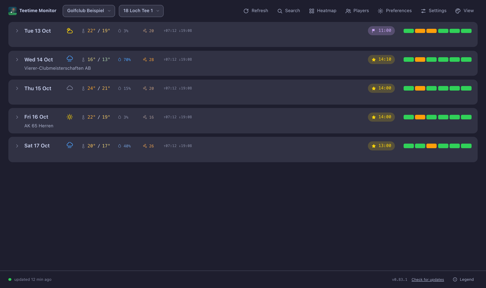

## What it does

Golf clubs all over German-speaking Europe publish their tee sheets through a booking platform called
**pc caddie**: who plays when, which times are still free. The sheet is public. Teetime Monitor reads it for
you and adds what the club's page doesn't tell you:

- ⛳ **How many times each day fit your rules** — tap the number to see them; open the day and the best one is
  starred: dry weather, little wind, room around your group, daylight to spare. Or the reason why there is none
  ("rain", "dark").
- 🌦 **The forecast for each tee time**, not just for the day.
- 🌙 **A warning when a round wouldn't finish before sunset.**
- 👥 **Who is playing** — friends you mark get a star.
- 🔔 **A heads-up when your booking changes**: someone joins your flight, the forecast turns.
- 📈 **A crowd heatmap** that learns over the weeks which hours really fill up.

**It books only when you press the button.** Click a free time and choose *Book now*: the app books it on pc caddie
with your own login, with any friends from your pc caddie friends list you tap or guests you add, and pc caddie sends
its usual confirmation e-mail. Your own booking can be cancelled the same way. Nothing is booked automatically or on a schedule.

## Two ways to use it — same data, same advice

| 🖥 **In your browser** (`teetime-monitor-web`) | ⌨️ **In the terminal** (`teetime-monitor`) |
|---|---|
| Buttons, cards, colours — the easy one. Works on a phone or tablet too (see the Raspberry Pi below). | For people who live in a terminal: fast, keyboard only. |

  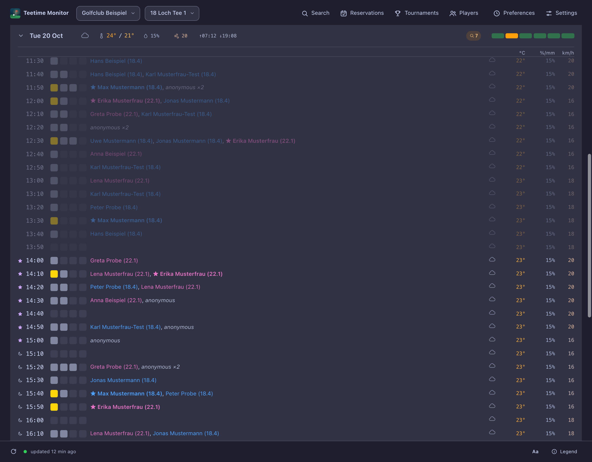
  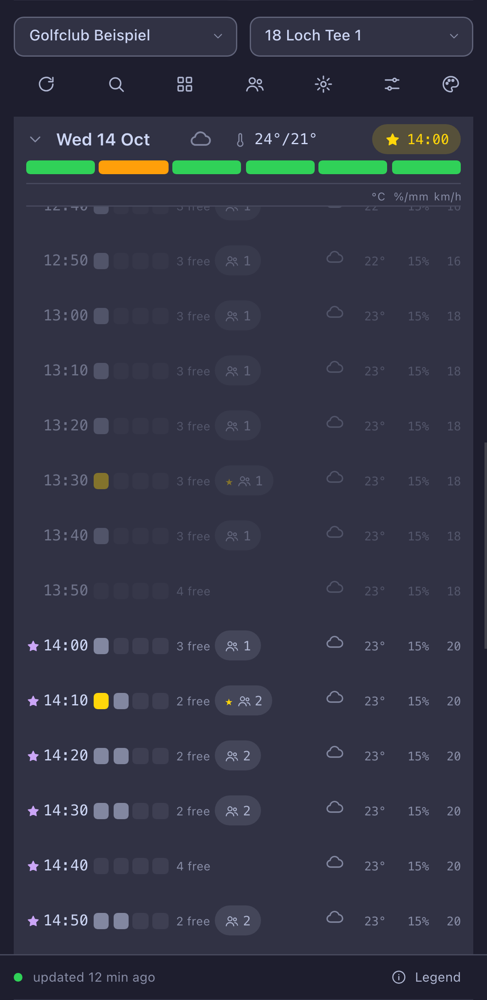

## Get started

Pick the line that fits you. Everything is free, and there is nothing to sign up for.

| You have | Do this |
|---|---|
| 🍎 **A Mac** | Install [Homebrew](https://brew.sh), then in the Terminal app: `brew install ltdan-88/teetime-monitor/teetime-monitor`. Start with `teetime-monitor-web` (browser) or `teetime-monitor` (terminal). |
| 🪟 **Windows** | Download **TeetimeMonitor-…-windows-x64.zip** from the [latest release](https://github.com/ltdan-88/teetime-monitor/releases/latest), right-click it → *Properties* → tick *Unblock*, then *Extract All*. Open the folder and double-click **TeetimeMonitor-Web.cmd**. (Windows may say "protected your PC": *More info → Run anyway* — the app has no paid signature.) Nothing is installed; everything stays in that folder. |
| 🐧 **Linux** | Download **TeetimeMonitor-…-linux-x86_64.tar.gz** from the [latest release](https://github.com/ltdan-88/teetime-monitor/releases/latest), unpack it and run `./TeetimeMonitor-Web.sh`. Or use Homebrew, as on the Mac. |
| 🍓 **A Raspberry Pi** (or any always-on computer) | Runs it all day for the whole family — every phone, tablet and computer at home opens it in the browser, behind a password: [**Raspberry Pi guide**](docs/RASPBERRY-PI.md). |

A window opens with your week. **Closing the window ends the program**, unless you run it on a Raspberry Pi.

### Your first five minutes

1. **Find your club.** Open the club menu at the top, choose **＋ Add club…** and search by name — or paste your
   club's pc caddie booking link. No login is needed to read the tee sheet.
2. **Look at the week.** Each card is a day. The number is how many times fit your rules (tap it to see them); a flag
   is a time you booked.
3. **Click a day** to open every tee time, with the players and the weather for each one. The ★ marks the best one.
4. **Tell it your rules** once under **Preferences** — which hours suit you on weekdays and weekends, how many
   players, how much wind or rain you accept. From then on the ★ follows your rules.
5. **Found your time?** Click it and choose *Book now* (needs your pc caddie login under Settings). The booking is made on
   pc caddie, and from then on the app keeps watch over it for you.

Optional, and it unlocks more: a **pc caddie login** (Settings) shows real player names, your own bookings and
the player directory.

## A tour

<table>
<tr>
<td width="50%"><b>Search</b> — every free time of the coming days, narrowed down with a tap: a day, a time of day, free spots, friends. It opens on your own rules, so you change one thing.  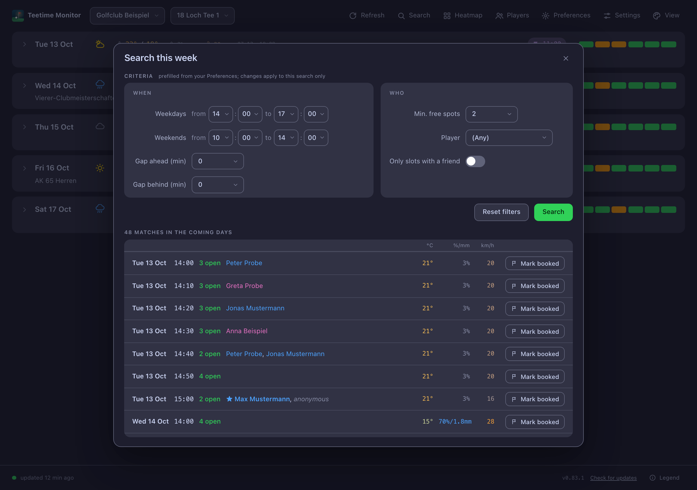</td>
<td width="50%"><b>Crowd heatmap</b> — which hours fill up on which weekday, learned from your own history. It needs a few weeks of data first.  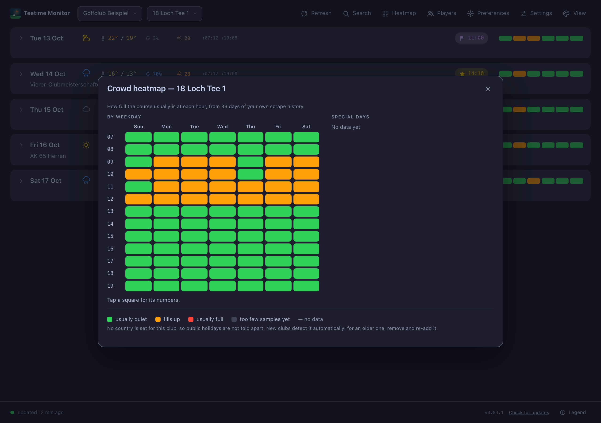</td>
</tr>
<tr>
<td width="50%"><b>Players</b> — star your friends; their names turn up bold with a ★, and a preference can favour their flights. Jump straight to a friend's next tee time.  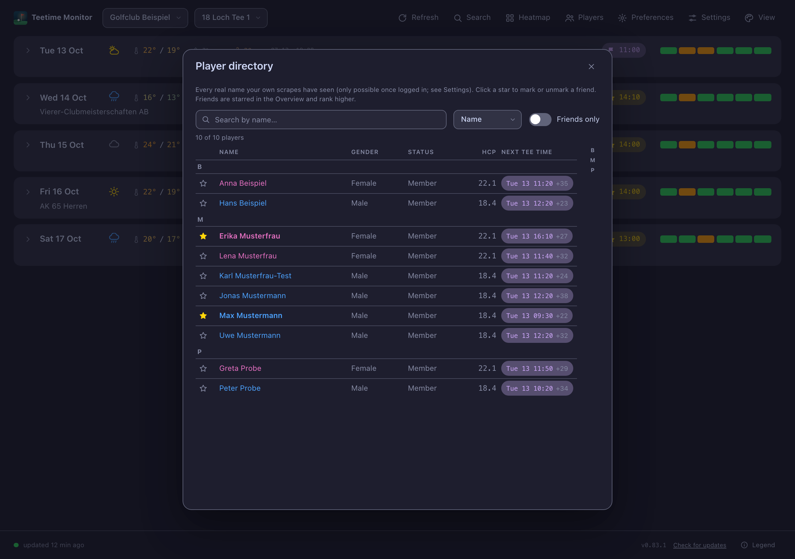</td>
<td width="50%"><b>On your phone</b> — the page adapts to phone and tablet screens. Touch and hold anything for an explanation. "Add to Home Screen" gives it an app icon.  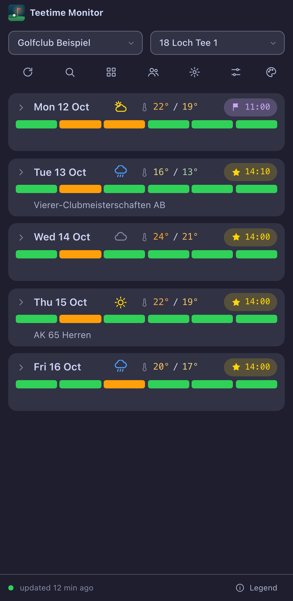</td>
</tr>
</table>

The ★ is not just the earliest time. Every playable time is scored on the weather over the whole round (against
*your* limits), room around your group, a quiet hour and daylight to spare — free, on your own computer, no AI.
An opened day says why, e.g. "dry · room around you · daylight to spare". If your course is too dark to finish
but a shorter one at the club still fits, it suggests that one instead. A day that isn't open for booking yet
shows 🔒 and when it opens. Tap the weather icon of an opened day to see its forecast on meteoblue, Windy, Ventusky
or Yr, and put a booking into Outlook, Google Calendar or Apple's calendar with one tap in **My reservations** (choose
both under Settings → Display). There each booking also has **your scorecard**: from the club's course data and your
Handicap Index, the shots you get on every hole, the score that is par for you, where to pick up, and how many
Stableford points beat your handicap.

### Prefer the terminal?

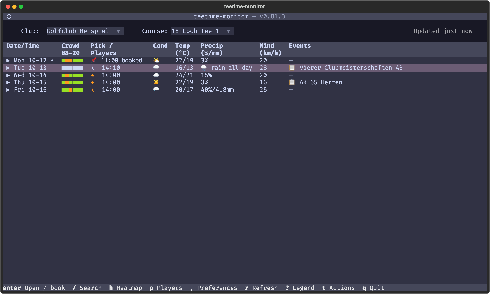

Same week, same ★, same rules. Every screen has a one-letter key, shown in the bar at the bottom:

| | Browser | Terminal |
|---|---|---|
| Open a day · book a free time or cancel your booking | click | **enter** |
| Refresh now | **r** | **r** |
| Search | **s** | **/** |
| Heatmap | **h** | **h** |
| Players | **p** | **p** |
| My reservations (see and cancel your bookings) | **b** | **b** |
| Tournaments (the club's calendar as a month grid) | **t** | – |
| Past days | **v** | – |
| Preferences · Settings | **e** · **,** | **,** · **s** |
| Add a club | **a** | **a** |
| Legend (what every symbol means) | **?** | **?** |
| Close a window · quit | **esc** | **esc** · **q** |

The terminal app also has an **Actions** menu (**t**) and eleven colour themes; the browser has the themes under
**Settings → Display**, together with English/German and units. The text size is the **Aa** at the bottom.

More terminal screenshots

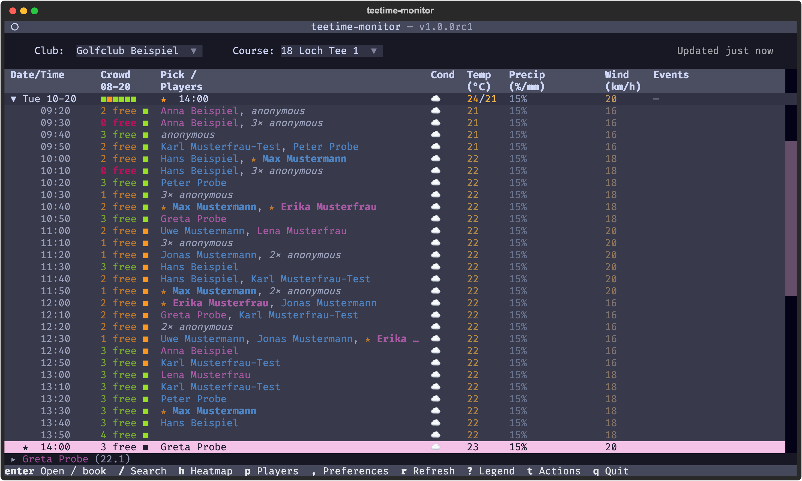

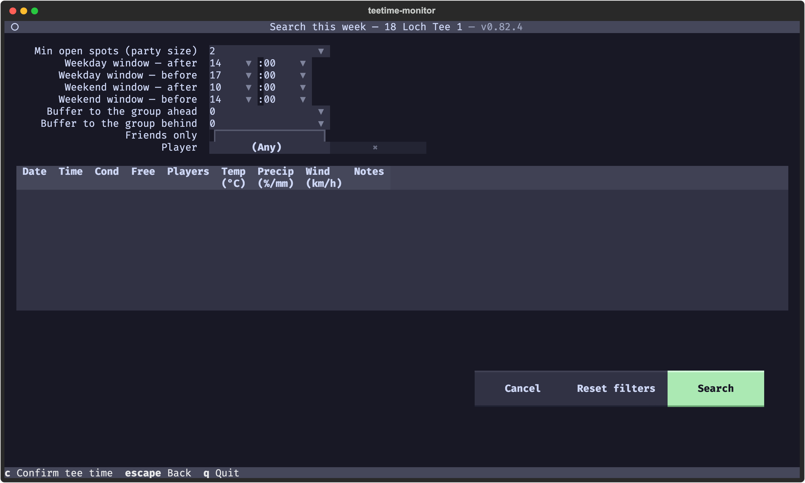

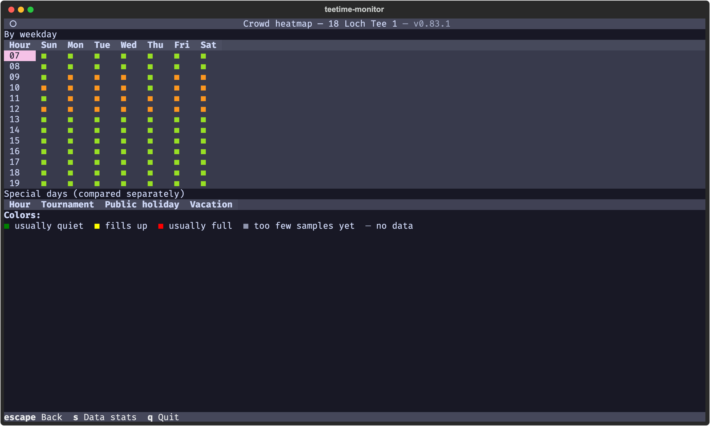

## Good to know

- **It keeps itself fresh while it is open.** To keep collecting tee sheets when it isn't — which the heatmap
  needs, because pc caddie deletes past days — let a Raspberry Pi do it, or set up a small scheduled job:
  [docs/ADVANCED.md](docs/ADVANCED.md).
- **Updates:** the page tells you when a new version exists ("Version X is available") and how to get it. On
  a Mac: `brew upgrade teetime-monitor`; on Windows and Linux: download the new zip and copy your old `userdata`
  folder into it; on a Raspberry Pi: one click on **Update now**, or let it install updates at night by itself
  (Settings → About).
- **Your data stays with you.** Your pc caddie login is only ever sent to pc caddie. The browser version listens
  on your own computer only (the Raspberry Pi version needs a password). Details for the careful:
  [docs/ADVANCED.md](docs/ADVANCED.md#privacy-and-safety).
- **Something wrong?** `teetime-monitor --doctor` prints a one-page health report you can paste into a bug
  report. Common cases:
  - *"No tee sheet found"* — some clubs don't publish one through pc caddie. Check the club id against its own booking link.
  - *A booking I made isn't showing* — bookings sync on each fetch; press **Refresh**.
  - *The heatmap says "no data yet"* — normal at the start; it needs a few weeks of history.
  - *No player names* — that needs the pc caddie login (Settings), and only works if your club shares names.

## What stays stable in 1.x

From 1.0 on, an update never breaks what you already have:

- **Your data and settings** — the clubs, the tee-sheet history, your bookings, friends and preferences — are read
  by every 1.x version as they are, and an update never asks you to set things up again.
- **Starting it** stays the same: `teetime-monitor-web`, `teetime-monitor`, the Windows and Linux start files,
  the Raspberry Pi service and its address.
- **It only books when you press the button**, and only under your own login.

What may change in a 1.x update: how things look and where they sit on the page, and new features. Something that
would need you to act — a setting that moves for good, a feature that goes — waits for 2.0 and is announced first.

## More

[Raspberry Pi guide](docs/RASPBERRY-PI.md) · [Settings, files, scheduled fetching, other install methods](docs/ADVANCED.md)
· [For developers](docs/DEVELOPING.md) · [MIT license](LICENSE)
